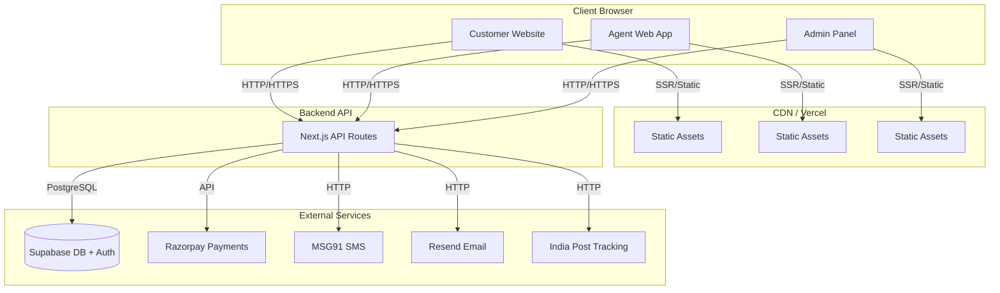
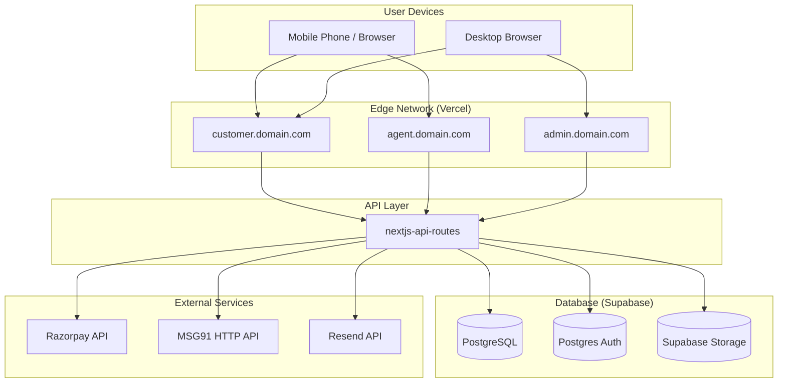

# Architecture - Courier Booking Platform

## What This Workspace Is

This workspace contains the Courier Booking Platform - a full-stack application for a digital agency in Delhi NCR. The platform consists of four main applications:

1. **Customer Website** - Public-facing booking platform with pricing calculator
2. **Agent Web App** - Mobile-optimized pickup management
3. **Admin Panel** - Operations dashboard for staff
4. **Backend API** - RESTful API for all business logic

## Repository Map

| Repo | Purpose | Language / stack | Publishes | Consumed by |
|---|---|---|---|---|
| `courier-booking-platform` | Main monorepo | Nx workspace, Next.js, TypeScript | — | — |
| `packages/ui` | Shared UI components | React, Tailwind CSS, Radix UI | npm package `@courier/ui` | All apps |
| `packages/models` | TypeScript models and types | TypeScript | npm package `@courier/models` | All apps |
| `packages/supabase-client` | Supabase client setup | Supabase JS SDK | npm package `@courier/supabase-client` | All apps |
| `packages/payments` | Razorpay integration | Razorpay SDK | npm package `@courier/payments` | API, customer |
| `packages/sms` | MSG91 SMS integration | HTTP client | npm package `@courier/sms` | API |
| `packages/email` | Resend email integration | Resend SDK | npm package `@courier/email` | API |
| `packages/print` | PDF generation | pdfmake, html2canvas | npm package `@courier/print` | API, admin |

## How They Fit Together



## Dependency Direction

```
apps/ → packages/
```

All apps depend on the shared packages. No circular dependencies exist.

- **apps/customer** → ui, models, supabase-client, payments, email, sms
- **apps/agent** → ui, models, supabase-client, sms
- **apps/admin** → ui, models, supabase-client, payments, email, print
- **apps/api** → models, supabase-client, payments, sms, email, print

## Build and Release Flow

| Stage | Trigger | Produces | Where it lands |
|---|---|---|---|
| CI | PR to `main` | Build artifacts, test results | GitHub Actions |
| Release | Tag on `main` | Docker image / Vercel deploy | Vercel |
| Preview | PR to feature branch | Vercel preview URL | Vercel |

## Cloud Footprint

| Account / project | Purpose | Regions |
|---|---|---|
| **Vercel** | Frontend hosting | Global (Edge) |
| **Supabase** | Database, auth, storage | [Region selected by user] |

## Runtime Topology



## Known Architectural Debt

| Item | Why it is that way | What it costs |
|---|---|---|
| Single monorepo | Simpler for small team, shared code | Larger CI cache, slower initial builds |
| No service worker for PWA | MVP phase | Offline capability not available |
| Manual India Post tracking entry | API not publicly available | Staff time required |
| No real-time updates | Cost control | Customers check status manually |

## Environment Configuration

| Environment | Purpose | Deployment |
|---|---|---|
| **Development** | Local development | `nx serve` |
| **Staging** | QA testing | Vercel preview |
| **Production** | Live customers | Vercel production |