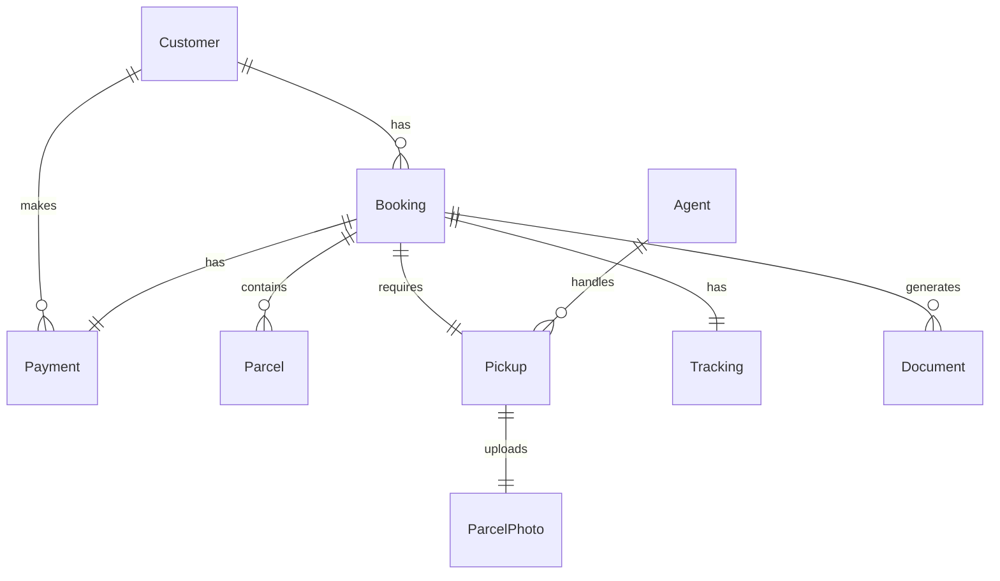

# Data Model - Courier Booking Platform

## Stores

| Store | Technology | Holds | Owner repo | Backup / retention |
|---|---|---|---|---|
| **PostgreSQL (Supabase)** | Supabase Database | All business data: bookings, parcels, customers, agents, payments, tracking | `packages/supabase-client` | Daily snapshots, 90-day retention |
| **Storage (Supabase)** | Supabase Storage | Parcel photos, PDF invoices, customs forms | `packages/supabase-client` | 1-year retention |
| **Auth (Supabase)** | Supabase Auth | User accounts and sessions | `apps/api` | Indefinite (GDPR compliance) |

## State That Is Not A Database

| State | Where | Who writes it | What happens if it is lost |
|---|---|---|---|
| Next.js build cache | `dist/` | `nx build` | Rebuild required, safe to lose |
| Supabase refresh tokens | Browser storage | Auth flow | User re-authenticates |
| Payment reconciliation state | Redis (optional) | Payment webhook handler | Reconciliation run required |

## Entities

### **Customer**

- **Identity**: `customer_id` (UUID) + `phone` (unique, India format)
- **Owned by**: `apps/api`
- **Lifecycle**: Created at booking, never deleted (GDPR: anonymize on request)
- **Scoping**: None (multi-tenant by brand)
- **Referenced by**: `booking`, `payment`

**Fields**:
- `customer_id` (UUID, PK)
- `phone` (text, unique, India format: +91XXXXXXXXXX)
- `name` (text)
- `email` (text, nullable)
- `created_at` (timestamp)
- `updated_at` (timestamp)

### **Booking**

- **Identity**: `booking_id` (UUID) + `booking_reference` (human-readable)
- **Owned by**: `apps/api`
- **Lifecycle**: Created when customer pays, soft-deleted on cancellation
- **Scoping**: None
- **Referenced by**: `parcel`, `payment`, `pickup`

**Fields**:
- `booking_id` (UUID, PK)
- `booking_reference` (text, unique: HB-CUR-XXXXXX)
- `customer_id` (UUID, FK → customer)
- `status` (enum: pending, paid, cancelled, completed)
- `pickup_date` (date)
- `pickup_address` (jsonb: address, landmark, instructions)
- `total_weight_kg` (decimal)
- `total_price` (decimal)
- `created_at` (timestamp)
- `updated_at` (timestamp)

### **Parcel**

- **Identity**: `parcel_id` (UUID)
- **Owned by**: `apps/api`
- **Lifecycle**: Created with booking, deleted when booking cancelled
- **Scoping**: `booking_id` (FK)
- **Referenced by**: `tracking`, `payment` (if weight adjustment)

**Fields**:
- `parcel_id` (UUID, PK)
- `booking_id` (UUID, FK → booking)
- `weight_kg` (decimal)
- `length_cm` (decimal)
- `width_cm` (decimal)
- `height_cm` (decimal)
- `description` (text)
- `value_inr` (decimal, for customs)
- `created_at` (timestamp)

### **Payment**

- **Identity**: `payment_id` (UUID) + `razorpay_payment_id`
- **Owned by**: `apps/api`
- **Lifecycle**: Created when payment initiated, updated on webhook
- **Scoping**: `booking_id` (FK)
- **Referenced by**: `booking` (status update)

**Fields**:
- `payment_id` (UUID, PK)
- `booking_id` (UUID, FK → booking, unique)
- `razorpay_payment_id` (text, unique)
- `amount_cents` (integer)
- `currency` (text: INR)
- `status` (enum: initiated, captured, failed, refunded)
- `payment_method` (enum: upi, card, netbanking, wallet)
- `created_at` (timestamp)
- `updated_at` (timestamp)
- `captured_at` (timestamp, nullable)

### **Pickup**

- **Identity**: `pickup_id` (UUID)
- **Owned by**: `apps/api`
- **Lifecycle**: Created when booking paid, completed when agent marks done
- **Scoping**: `booking_id` (FK)
- **Referenced by**: `agent`, `parcel_photo`

**Fields**:
- `pickup_id` (UUID, PK)
- `booking_id` (UUID, FK → booking, unique)
- `agent_id` (UUID, FK → agent, nullable)
- `status` (enum: assigned, scanned, weight_verified, photo_captured, completed)
- `scheduled_at` (timestamp)
- `completed_at` (timestamp, nullable)
- `actual_weight_kg` (decimal, nullable)
- `balance_amount` (decimal, nullable)
- `created_at` (timestamp)
- `updated_at` (timestamp)

### **Agent**

- **Identity**: `agent_id` (UUID) + `phone` (unique)
- **Owned by**: `apps/api`
- **Lifecycle**: Created by admin, soft-deleted on deactivation
- **Scoping**: None
- **Referenced by**: `pickup`

**Fields**:
- `agent_id` (UUID, PK)
- `phone` (text, unique)
- `name` (text)
- `email` (text, nullable)
- `assigned_area` (text)
- `is_active` (boolean)
- `created_at` (timestamp)
- `updated_at` (timestamp)

### **Tracking**

- **Identity**: `tracking_id` (UUID)
- **Owned by**: `apps/api`
- **Lifecycle**: Created when admin enters India Post tracking number
- **Scoping**: `booking_id` (FK)
- **Referenced by**: None (read-only from customer perspective)

**Fields**:
- `tracking_id` (UUID, PK)
- `booking_id` (UUID, FK → booking, unique)
- `india_post_tracking_number` (text, unique)
- `status` (enum: booked, in_transit, out_for_delivery, delivered, failed)
- `status_details` (text, nullable)
- `last_updated` (timestamp)
- `created_at` (timestamp)
- `updated_at` (timestamp)

### **Parcel Photo**

- **Identity**: `photo_id` (UUID)
- **Owned by**: `apps/api`
- **Lifecycle**: Created when agent uploads photo
- **Scoping**: `pickup_id` (FK)
- **Referenced by**: Storage URL

**Fields**:
- `photo_id` (UUID, PK)
- `pickup_id` (UUID, FK → pickup)
- `storage_url` (text, Supabase Storage path)
- `uploaded_at` (timestamp)

### **Document**

- **Identity**: `document_id` (UUID)
- **Owned by**: `apps/api`
- **Lifecycle**: Created when PDF generated, deleted on request
- **Scoping**: `booking_id` (FK)
- **Referenced by**: Storage URL

**Fields**:
- `document_id` (UUID, PK)
- `booking_id` (UUID, FK → booking)
- `document_type` (enum: sticker, cn22, cn23, invoice)
- `storage_url` (text, Supabase Storage path)
- `created_at` (timestamp)

## Schema Change Rules

1. Additive or backwards-compatible changes: allowed
2. Dropping columns: two-phase (deprecate → remove in next major)
3. Never edit applied migrations
4. Never run migrations by hand from an agent session

## Retention and PII

| Data | Contains PII? | Retention | Deletion path |
|---|---|---|---|
| Customer name, phone, email | Yes | 7 years (tax) | GDPR request → anonymize |
| Booking details | Yes | 7 years (tax) | GDPR request → anonymize |
| Parcel photos | Yes (facial recognition risk) | 90 days | Manual or scheduled purge |
| Payment records | Yes (financial) | 7 years (tax) | GDPR request → anonymize |
| Tracking data | No | Indefinite | Manual purge |
| Documents (PDFs) | Yes (customer data) | 7 years | GDPR request → delete |

## ER Diagram

