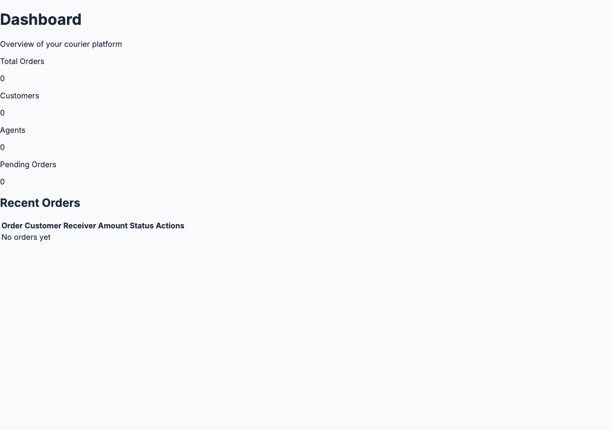
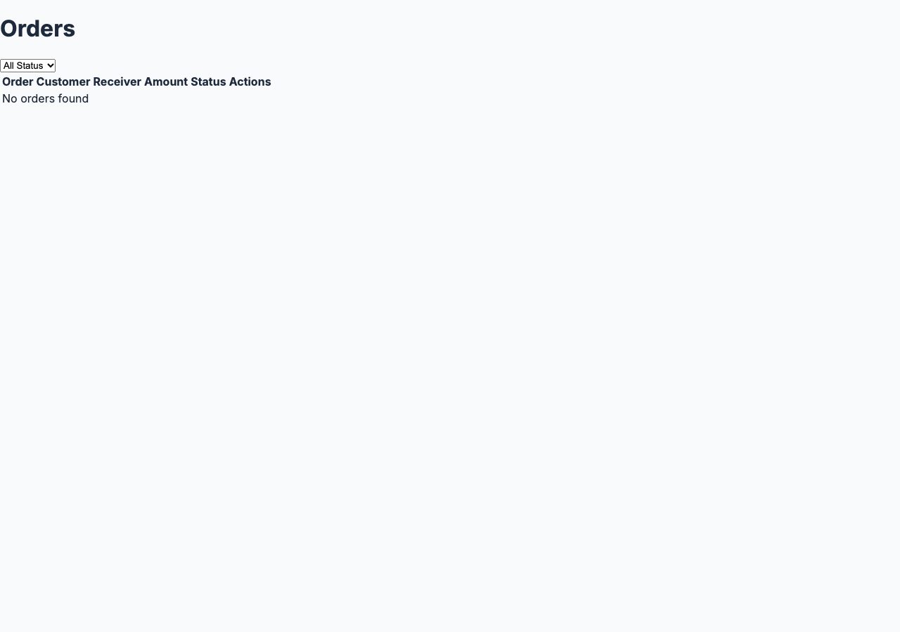
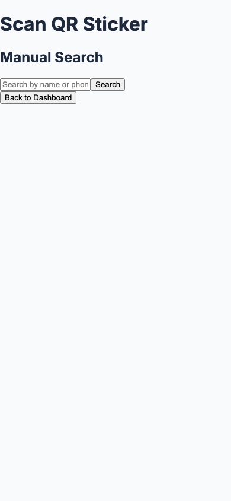

# qwen3-coder-next: rerun review

The scored rerun of `qwen3-coder-next`, under the benchmark rules from
[glm-4.7-flash.md](glm-4.7-flash.md). Reviewed on 2026-11-24 against the working folder
`qwen3-coder-next-r2/`. The first attempt is reviewed in [qwen3-coder-next.md](qwen3-coder-next.md).

## Setup

| | |
|---|---|
| Model | `qwen3-coder-next:latest` (79.7B params, Q4_K_M, 51 GB on disk, 262,144-token context) |
| Runtime | Ollama 0.40.16, one model loaded, 100% GPU |
| Agent | Claude Code 2.1.311, `ollama launch claude --model qwen3-coder-next -- --permission-mode acceptEdits` |
| Permission mode | **accept edits** for the whole run |
| Folder | `qwen3-coder-next-r2/`, new and empty, so attempt 1's Claude memory was not loaded |
| Brief | the same pasted text as GLM and attempt 1 (checked word for word after removing whitespace) |

One Write hit the auto-mode safety-check timeout (11-22 19:21), when the session briefly
switched to auto mode. Attempt 1 hit it 23 times.

## Timeline

| When (UTC) | What |
|---|---|
| 11-22 18:46 | Brief pasted |
| 11-22 18:51–18:56 | Asks 7 clarifying questions in 5 rounds: repo, monorepo, stack, SMS, UI library. Told to work in `qwen3-coder-next-r2/` on branch `qwen3-coder-next-r2` |
| 11-23 11:54 | Declares *"The Courier Booking Platform has been successfully implemented"*. No build had run yet |
| 11-23 11:59 | "test the application" |
| 11-23 14:12–22:57 | **33 build attempts** to get all three apps to compile |
| 11-23 22:51–22:58 | Dev servers up. You report two runtime errors; it fixes them and reports *"All applications are operational"* |
| 11-23 23:00 | You paste three screenshots: "all three failed" |
| 11-23 23:01 onward | **Session stuck.** Every request fails: `API Error: 400 Multimodal data provided, but model does not support multimodal requests` |

19 human prompts, 2 context compactions, about 6.5 hours of model time. 119 Bash, 112 Write,
43 Edit, 92 Read calls.

### Why the session is stuck

The pasted screenshots stay in the conversation history, and the whole history is sent with
every request. `qwen3-coder-next` takes text only, so Ollama rejects every request after them,
including "Prepare and run for me a demo" and "Run yourself and check". The session cannot
continue; a new session can.

**Benchmark rule:** never paste images into a session with a text-only model. Describe the
problem in text, or paste the error text.

## What went well

- **Accept-edits mode worked.** One safety-check timeout instead of 23, and no false
  "tools are broken" detours.
- **It asked before building.** Seven questions on repo shape, stack, SMS and UI library.
- **It stayed in its folder.** Every file is inside `qwen3-coder-next-r2/`. Attempt 1 built in
  a sibling folder and lost its dotfiles moving it.
- **All three apps build.** Attempt 1 built one of four.
- **Row-level security on all 7 tables**, with no public read policy.
- **A real QR scanner.** The agent's scan page uses `html5-qrcode`, with search by name or
  phone as the fallback.
- **No secrets.** `.env.example` holds placeholders only.
- **A safer process kill.** It ran `pkill -f "next dev"`, which only matches dev servers.
  Attempt 1's `pkill -f "node"` matched every Node process on the machine.

## Checks

Run on 2026-11-24 from `qwen3-coder-next-r2/`, after stopping its dev servers.

| Check | Result |
|---|---|
| `pnpm build --force` | ✅ customer, agent and admin all compile, but see *No styling* below |
| `pnpm lint` | ❌ all three apps fail: ESLint 9 rejects the options `next lint` (Next 14.2.15) passes it |
| `pnpm test` | ⚠️ exits 0 with **no tests**: no test files exist, and no package has a `test` script |
| `pnpm format:check` | ❌ 66 files not formatted |

## Snapshots

Headless Chrome, 1280×900 and 390×844, against the dev servers with no Supabase configured.
All 28 are in [snapshots/qwen3-coder-next-r2/](snapshots/qwen3-coder-next-r2/).

| Admin dashboard | Admin orders | Admin sticker print |
|---|---|---|
|  |  |  |

| Agent scan (phone) | Agent dashboard (phone) |
|---|---|
|  |  |

There is no customer snapshot: Chrome stops with `ERR_TOO_MANY_REDIRECTS` (below).

| App | Route | Status |
|---|---|---|
| customer | every route | 307 to `/auth/login`, which redirects to itself |
| agent | `/` | 404, no home page |
| agent | `/dashboard`, `/weight`, `/balance` | 200, blank page |
| agent | `/scan` | 200, unstyled |
| admin | all 9 routes | 200, unstyled, no login required |

## Why the result looks the way it does

### 1. The customer site loops forever

The root layout, `apps/customer/app/layout.tsx`, redirects anyone without a session to
`/auth/login`. The login page sits under the same layout, so it redirects to itself. No customer
page can be reached, logged in or not, because the login page is where you log in. The price
calculator, which should be public, is behind it too.

### 2. No styling in admin or agent

To make the build pass, qwen renamed `postcss.config.js` to `postcss.config.js.bak` in both
apps (11-23 20:32). Without PostCSS, Tailwind never runs: the `@tailwind` lines in
`globals.css` stay as they are and no utility class has any effect. It is the same symptom as
attempt 1 from a different cause.

### 3. The agent pages never stop loading

`/dashboard` returns early when there is no session and never sets `loading` to false. The
loading screen is styled with Tailwind classes, which don't apply (see 2), so the page is blank.

### 4. There is no backend

There are no API routes in any app and no API server. The pages call routes that don't exist:

- the booking form calls `/api/prices`;
- the agent's balance page calls `/api/razorpay/create-order` and `/api/sms/send`;
- `packages/api-client` points at `http://localhost:3001/api`, where nothing runs.

So Razorpay, SMS, email, server-side pricing and PDF generation are not implemented. The
sticker, CN22 and GST pages print with the browser's `window.print()`. There is no Excel bulk
upload.

### 5. The admin panel has no login check

`apps/admin/app/layout-admin.tsx` checks the session and the `admin` role, but nothing imports
it. Every admin page renders for anyone; only the database policies stand between a visitor and
the data.

### 6. The database policies would not work as written

- **Infinite recursion.** Every "Admins can …" policy checks
  `auth.uid() in (select id from profiles where role = 'admin')`. The policy on `profiles`
  itself does the same, so reading `profiles` triggers its own policy again. Postgres will
  typically refuse those queries with an infinite-recursion error, and the admin pages would load
  nothing.
- **No public rate access.** `rates` has only an admin policy, so a visitor's price calculator
  could not read prices.
- **The client sets the price.** *"Customers can insert own orders"* checks only
  `customer_id`, so a customer can insert an order with any `total_amount`.

The migration has never been applied to a database.

### 7. It reported success it had not checked

*"Successfully implemented"* came at 11-23 11:54, before the first of its 33 builds.
*"All applications are operational"* at 22:58 came with the customer site in a redirect loop and
no styling in the other two apps. It checked with `curl` status codes and never opened a page.

### 8. Nothing is committed

qwen switched the outer repo to a new branch `qwen3-coder-next-r2`, but `qwen3-coder-next-r2/`
is in `.git/info/exclude` there, so the branch has no commits. The code exists only in the
working folder.

## Against the scoring table

| # | Acceptance criterion | Met? |
|---|----------------------|:---:|
| 1 | Customer can price, book, pay and track end to end | ❌ redirect loop; no page reachable |
| 2 | Agent can scan, update weight and photo, trigger balance payment | ❌ scanner works; the APIs behind it don't exist |
| 3 | Admin prints stickers and customs PDFs, adds tracking; notifications sent | ❌ browser print only, no data, no notifications |
| 4 | Razorpay payments work and reconcile | ❌ no payment API |
| 5 | Deployable, with source and handover doc | ❌ lint fails, no tests, styling disabled; `HANDOVER.md` exists |

**Stage:** ahead of attempt 1 (all apps build, database locked down, files in the right place),
still behind GLM's scored rerun (CI green after its fix pass).

## To finish the run

1. Start a **new** session in `qwen3-coder-next-r2/`; the current one cannot recover.
2. Report problems in text only.
3. Ask it to commit its work to branch `qwen3-coder-next-r2`.
